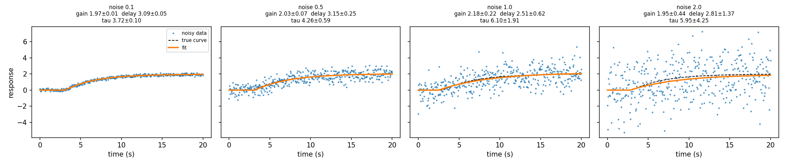
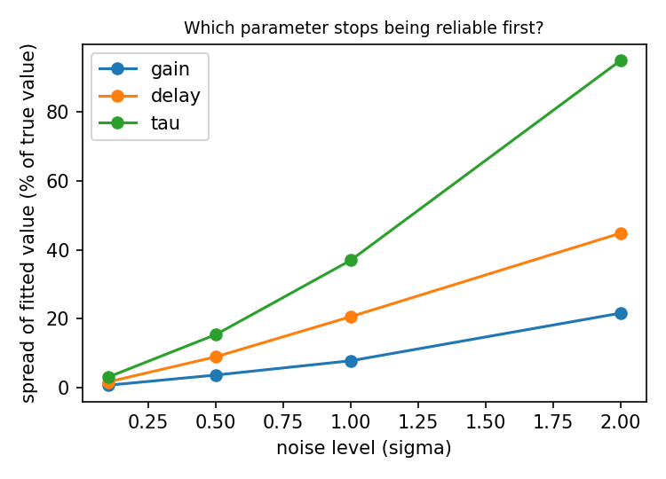

# fit-demo

A small study of **how reliable fitted parameters are as measurement noise grows**.

It simulates a noisy delayed first-order response (like an RC circuit that starts
charging after a delay), recovers its three parameters with `scipy.optimize.curve_fit`,
and repeats the fit many times at increasing noise levels.

```
response(t) = 0                                      for t < delay
response(t) = gain * (1 - exp(-(t - delay) / tau))   for t >= delay
```

Unknowns: `gain`, `delay`, `tau` (time constant). True values used: gain 2.0, delay 3.0 s, tau 4.0 s.

## Run it

```bash
pip install numpy scipy matplotlib
python3 fit_demo.py            # prints tables, saves two PNG figures
python3 fit_demo.py --show     # also opens the figures on screen
```

The random seed is fixed (`default_rng(0)`), so the numbers below reproduce exactly
on the same library versions.

## Results

One fit at noise 0.1 recovers the truth: gain 1.99 ± 0.01, delay 2.96 ± 0.05, tau 4.06 ± 0.11.

Spread of the fitted values over 100 repeated fits (std as % of the true value):

| Noise (sigma) | gain | delay | tau |
|---|---|---|---|
| 0.1 | 1% | 2% | 3% |
| 0.5 | 4% | 9% | 15% |
| 1.0 | 8% | 21% | 37% |
| 2.0 | 22% | 45% | 95% |

The gain stays the most stable. The time constant is the first parameter to become unreliable.





## Files

- `fit_demo.py`: the model, the simulation, the fitting, the noise test and the plots
- `fit_examples.png`: one fitted example per noise level
- `noise_spread.png`: relative spread of each parameter against noise level
- `run_output.txt`: the console output of one run

## Limitations

- Simulated data only. No real measurements.
- One model shape and one fixed seed.
- Gaussian noise of constant size. Real signals can have changing or non-Gaussian noise.
- Parameter spread depends on the sampling (400 points over 20 s) and on the starting guess.

## How this was made

The model and script were drafted with AI assistance (Claude). I [WRITE HERE, in your
own words and only what is true: for example, ran it, changed parameters, tested bad
starting guesses, extended it] and I take responsibility for the content.
